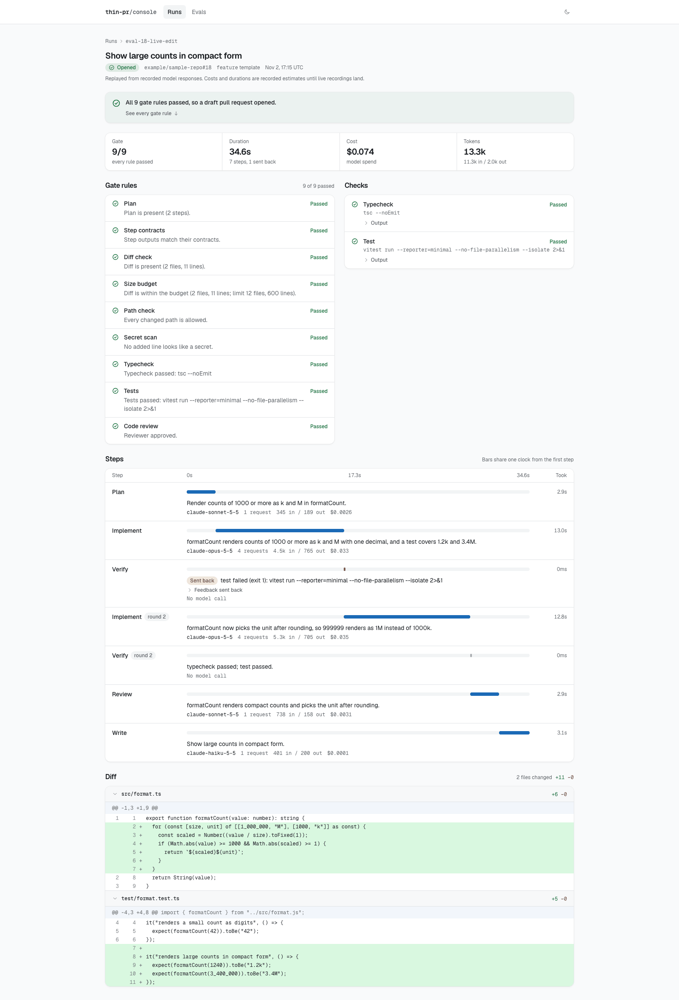
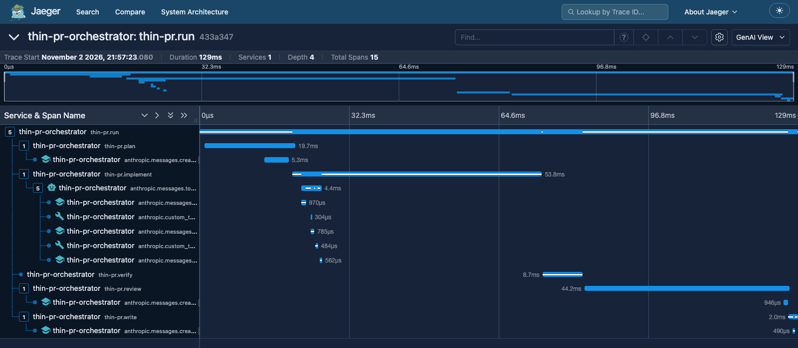
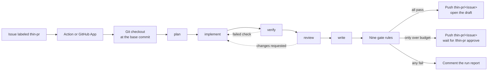

# Thin PR Orchestrator

Label a GitHub issue `thin-pr`, and a fixed TypeScript workflow plans, edits, checks, and reviews a change, then opens a draft pull request only when nine gate rules pass. A change over the template's size budget waits for a person to approve it.





[Issue #25](https://github.com/kocherev/thin-pr-orchestrator/issues/25) is a live run on this repository. [The Action run](https://github.com/kocherev/thin-pr-orchestrator/actions/runs/41564965359) opened [draft #27](https://github.com/kocherev/thin-pr-orchestrator/pull/27), which edits an existing function in `packages/github/src/cli.ts` and its test, 2 files and 13 lines. Sonnet 5.5 planned. Opus 5.5 implemented through the `read_file`, `search`, `replace`, and `run_check` tools. Sonnet 5.5 reviewed, and Haiku 5.5 wrote the title. The run ran `pnpm typecheck` and `pnpm test` on the checkout, posted all nine gate rules as check runs, and logged `Model spend: 0.809136 USD`. Its trace has 44 spans.

GitHub does not start workflows for events made with a workflow's `GITHUB_TOKEN`, so CI did not run on #27. The GitHub App in `packages/app` pushes with an installation token, which does start them.

## Why it is built this way

- **No model in the control plane.** `packages/core` runs a YAML template. The step order, the retries, and the loop caps are data. `pnpm lint` fails if `packages/core` imports a model client. A model's reply can send the run back through a loop the template allows. It never adds a step, raises a cap, or opens the draft.
- **The gate measures the code.** It reads `git diff` against the base commit, the exit codes of the real typecheck and test commands, the path rules, and a secret scan of the added lines. A model's list of changed files is never evidence.
- **Checks never see the keys.** On GitHub and in the App, the repo's checks run as a second OS user. Code the model wrote cannot read the API key or the push token from any process, and cannot plant a git hook. CI proves it on a real runner with a canary secret.
- **Every run is replayable and traced.** Each step event goes to a SQLite log with its full output and usage, and `replay` rebuilds the run from that log. Model calls record to cassettes that CI replays offline. The Action and `pnpm trace` export each run as one OpenTelemetry trace, with tokens and cost on every model request.

## How a run flows



The draft body and the run report lead with the outcome and a table of the nine rules, failing rules first. Collapsible sections follow for the plan, each check's log tail, the review notes, and every step attempt with its cost.

## Working with it

1. Label the issue. `thin-pr` runs the feature template. `thin-pr:bugfix` and `thin-pr:docs` run the other two.
2. Watch the progress comment. The run posts one comment on the issue and edits it at each step, with the status, attempt, loop, and cost so far, and a link to the Actions run or the App delivery. When the run ends, the comment is the run report.
3. Approve a big change. A change over the budget is pushed to `thin-pr/<issue>`, and the report asks for approval. Comment `/thin-pr approve` on the issue to open the draft.
4. Retry or cancel. `/thin-pr retry` starts a fresh run with the issue's label. `/thin-pr cancel` stops a run that waits for approval and deletes its branch.
5. Review the draft. Request changes or leave comments on the draft, as you would for a teammate. A revise run answers the review with one commit on the branch and one reply that says what changed for each comment, or why nothing was pushed.

Only owners, members, and collaborators can give a command or start a revise run. thin-pr ignores everyone else, and every event a bot sends. A command comment gets an eyes reaction when the run reads it, then +1 when it is done, or confused and a short reply with the reason when it is refused. Any other word after `/thin-pr` gets the list of commands.

## Quickstart

You need Node.js 22.15 or later, pnpm 10.33.4, git 2.28 or later, and Python 3.10 or later as `python3`. `pnpm trace` needs that Node.js version, the tests and the eval create scratch git repos, and the Python eval cases run `python3`.

```bash
git clone https://github.com/kocherev/thin-pr-orchestrator.git
cd thin-pr-orchestrator
corepack enable && corepack prepare pnpm@10.33.4 --activate
pnpm install
pnpm verify
```

`pnpm verify` runs lint, typecheck, test, eval, eval:judge, and trace in that order and stops at the first failure. It needs no API key.

To run an issue against a local checkout, replay eval case 01 on a copy of the sample package:

```bash
cp -R evals/sample-repo /tmp/sample
git -C /tmp/sample init -q -b main && git -C /tmp/sample add -A && git -C /tmp/sample commit -qm base
PATH="$PWD/node_modules/.bin:$PATH" THIN_PR_CASSETTE=evals/cases/01-clamp-decrement/cassette.jsonl \
  pnpm thin-pr run --repo /tmp/sample --issue "Clamp decrement at zero"
```

The command prints the report, commits the change to a local branch `thin-pr/local-1`, and pushes nothing. Set `THIN_PR_MODEL=live` and `ANTHROPIC_API_KEY` to call the models instead. `docs/mcp.md` covers the command and the MCP server.

To run on GitHub, add the `ANTHROPIC_API_KEY` repository secret, allow GitHub Actions to create pull requests, create the label `thin-pr`, and add it to an issue. `.github/workflows/thin-pr.yml` must be on the default branch. `docs/deploy.md` sets up the GitHub App instead.

## Results

**On a real repo.** thin-pr ran ten issues on [kb-copilot](https://github.com/kocherev/kb-copilot), a Python and TypeScript monorepo it had never seen. The repo owner wrote the issues and a hidden acceptance test for each, then reviewed every diff.

| Metric | Value |
| --- | --- |
| Owner verdict | 10/10 correct |
| Hidden acceptance tests | 9/10 pass. The owner traced the miss to the test itself. |
| Gate passed | 9/10. One correct fix was blocked by a false positive, now fixed. |
| Cost | $2.49 for all ten, $0.20 median per issue |
| Largest change | 6 files, 123 lines |

`evals/kb-copilot/README.md` has each issue, its diff, and what the eval changed in thin-pr.

**On the sample repos.** `pnpm eval` replays 26 labeled issues and runs each repo's checks for real: 21 against the TypeScript package in `evals/sample-repo` with `tsc` and `vitest`, and 5 against the Python package in `evals/sample-python` with `python3`. Some cases add hidden tests the implementer never sees. Fifteen cases should open a draft, two of them multi-file changes of 5 and 3 files. Ten should not: one per gate rule from `diff` to `review` except `budget`, an empty plan that fails before the gate, and three Python cases that fail `tests`, `paths`, and `secrets`. One case changes 13 files, one more than the feature budget, and must end waiting for approval.

| Metric | Value |
| --- | --- |
| Verdict accuracy | 26/26 (100.0%) |
| Resolve rate | 15/15 (100.0%) |
| Waited for approval | 1/1 |
| Cost per resolved case | 0.034382 USD |
| Judge agreement | pending live recording |

The sample-repo cassettes and the judge batch have no live recording yet, so those costs are token estimates and the judge has no score. The kb-copilot numbers above are live. `evals/README.md` has every case and the commands that record them.

## Model routing

`templates/feature.yaml` routes the `thin-pr` label. Its budget is 12 files and 600 changed lines, and one run may spend 5 USD. A bigger diff that passes every other rule pushes the branch and waits for `/thin-pr approve`. A model call that could pass the spend limit is not sent, and the run fails with a report. On kb-copilot the largest change was 6 files and 123 lines, and the most expensive run cost $0.71, so the limits leave room. `.thin-pr.yml` can override them. `templates/README.md` lists the other three templates, including `revise`, which answers reviews.

| Step | Model | Effort | Why |
| --- | --- | --- | --- |
| plan | `claude-sonnet-5-5` | medium | One structured reply. It may first read and search files, up to 8 turns, so each step names a file it has seen. |
| implement | `claude-opus-5-5` | high | The only step that writes code. It runs a tool loop of up to 60 turns, clears old tool results on the API side, and runs the checks itself. |
| verify | none | none | Runs `typecheck` and `test` from `.thin-pr.yml`. |
| review | `claude-sonnet-5-5` | high | Reads the patch and the check logs. Its verdict is a gate rule. |
| write | `claude-haiku-5-5` | low | Writes the draft title. Code builds the body. |
| judge, offline | `claude-sonnet-5-5` | medium | Grades what the rules cannot see. One message batch with one request per case, at half price. |

## Docs

- `docs/architecture.md`: packages, the step model, and the data flow.
- `docs/gate.md`: each rule, what it reads, and the eval case that trips it.
- `docs/security.md`: untrusted issue text, who can give a command, tool confinement, the check user, tokens, egress, and the spend cap.
- `docs/telemetry.md`: spans, attributes, and backends.
- `docs/deploy.md`: the GitHub App on Cloudflare.
- `docs/mcp.md`: the local command and the MCP server.
- `evals/README.md`: the cases, the judge, and the nightly live run.
- `evals/kb-copilot/README.md`: ten live runs on a real repo, graded by its owner.
- `apps/console/README.md`: the static console. `pnpm console:build` writes it to `apps/console/out`.
- `AGENTS.md`: commands and rules for changing the repo.

## License

MIT. See `LICENSE`.
