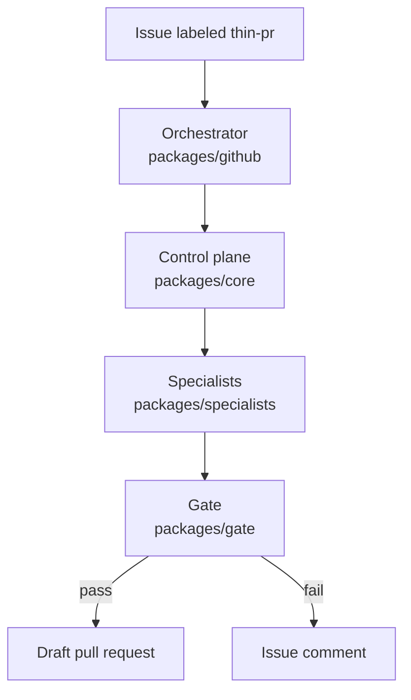
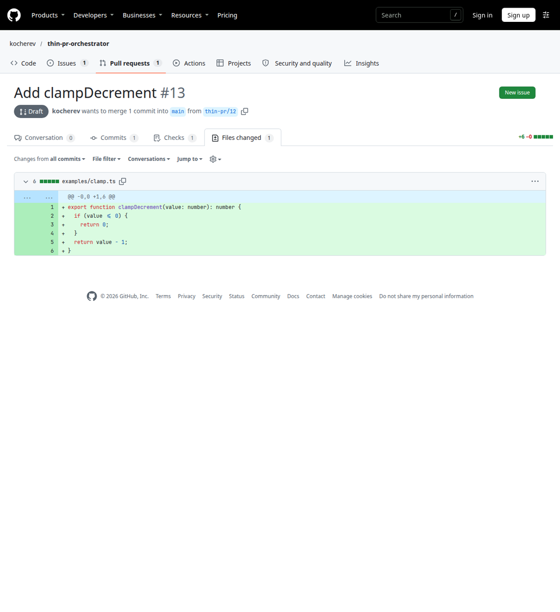

# Thin PR Orchestrator

A GitHub issue goes in. A fixed workflow runs in ordinary TypeScript, calls five specialists through a typed boundary, and opens a draft pull request when the gate passes. A person reviews the draft.

The control plane does not call a model. This tree injects a replay client that returns fixture JSON. The design note is `docs/design.md`.

## Control flow



`packages/github` is the only package that talks to GitHub. It loads `templates/small-feature.yaml` and asks `packages/core` to run that template. The control plane calls planner, implementer, tester, reviewer, and pr-writer, in that order, and appends every transition to SQLite. After pr-writer returns, the gate checks plan, tests, and the five specialist contracts. A pass tells the orchestrator to open a draft pull request. A fail tells it to comment the run report on the issue and open nothing.

## Fork in 5 minutes

Clone, install, then label an issue or replay the evals on your machine.

You need Node.js 22.13 or later. The version file is `.nvmrc`. pnpm 10.33.4 is the `packageManager` field in `package.json`. Corepack ships with Node 22.

```bash
git clone https://github.com/kocherev/thin-pr-orchestrator.git
cd thin-pr-orchestrator
corepack enable
corepack prepare pnpm@10.33.4 --activate
pnpm install
```

Use your fork's URL when you are changing the repo. `.env` is not required for the commands below. If you set a token yourself, copy `.env.example` to `.env` and keep the real value out of git.

### Label an issue

GitHub reads `.github/workflows/thin-pr.yml` from the default branch. Push that branch before you expect a label to start a run. The workflow listens for `issues` with type `labeled`, and the job runs only when the label name is `thin-pr`.

1. Push the default branch so the workflow file is on it.
2. In the repository, create the label `thin-pr`.
3. Open an issue.
4. Add the label `thin-pr`.

The run uses `GITHUB_TOKEN` from the workflow. It creates `thin-pr/<issue number>` from the default branch tip. After implement, the runner reads the file bytes it would commit. It does not trust the model file list or the model `passed` flag. When that measured diff changes non-whitespace text and stays inside `evals/budget.json`, the runner commits those files. The commit message is `Apply thin-pr/#<issue number>`. Checks after that commit, and the draft pull request, use that commit as their head.

An empty diff, a whitespace-only diff, or a diff outside the budget fails the gate. The issue gets the run report, and no draft is opened. Recorded diffs under `evals/diffs` are what `pnpm eval` measures. The eval does not push them.

Each template step posts a check named `thin-pr / <step>`. Each gate rule posts `thin-pr / gate / <rule>`. The rule check title is `PASS` or `FAIL`. The summary is that verdict, a colon, and the reason. The rules are `plan`, `tests`, `contracts`, `diff`, and `budget`.

When every rule passes, the run opens a draft pull request into the default branch. The title comes from the pr-writer output. The body is the plan, the test results, and the run report, in that order. A failed step or a failed rule is marked failure, the issue gets a comment that starts with `## Run report`, and no pull request is opened.

Adding the label again tries to create the same branch. If that ref already exists, the run fails and the issue gets another report.

### Replay on your machine

No token and no GitHub repository.

```bash
pnpm eval
pnpm test
```

`pnpm eval` prints the gate pass rate and the diff-budget stats. It exits 0 when the pass rate is at least `evals/baseline.json`. The budget rule is part of that gate. `pnpm test` runs Vitest, including the label-path test and the SQLite replay test.

## Example draft pull request

This is the body `packages/github` writes for `fixtures/gate-pass.json` and `fixtures/sample-issue-labeled.json`. The test in `packages/github/src/run.test.ts` drives that pair with run id `run-7` and a measured two-line change in `src/stub.ts`. The model fixture lists files, and the runner still measures the bytes. The pull request title is `Fix the stub`. The head is `thin-pr/7`, the base is `main`, and `draft` is true.

The pr-writer field `body` is not copied into the pull request. The Action builds the body below.

A workflow run writes the same sections. Its run line uses `gha-` plus `GITHUB_RUN_ID` instead of `run-7`.

```text
## Plan

Plan the stub change.

- edit the stub

## Test results

Stub checks passed.

Tests passed.

## Run report

- Run: run-7
- Template: small-feature
- Issue: 7
- Branch: thin-pr/7

### Steps
- plan: success. Plan the stub change.
- implement: success. Apply the stub change.
- test: success. Stub checks passed.
- review: success. Stub review found nothing.
- gate/plan: success. PASS: Plan is present (1 step).
- gate/tests: success. PASS: Tests passed.
- gate/contracts: success. PASS: Specialist outputs match their contracts.
- gate/diff: success. PASS: Diff is present (1 file, 2 lines).
- gate/budget: success. PASS: Diff is within the budget (1 file, 2 lines; limit 2 files, 16 lines).
- gate: success. pass
```

`fixtures/gate-fail.json` is the other path. Tests are recorded as not passed, the tests rule fails, the issue gets the run report, and no draft is opened.

## Replay evals

`pnpm eval` replays 12 labeled issues through `templates/small-feature.yaml` and the gate. The model text is the recorded JSON under `evals/responses`. The committed floor in `evals/baseline.json` is a pass rate of 8/12, which the report prints as 66.7%. `evals/budget.json` allows 2 files and 16 lines. A miss fails the budget rule. `scripts/eval.test.ts` locks this report.

| Stat | Value |
| --- | --- |
| Cases | 12 |
| Gate pass | 8/12, 66.7% |
| Baseline | 66.7% |
| Diff budget | 2 files, 16 lines |
| Within budget | 10/12 |
| Files changed | min 1, median 1, max 4 |
| Lines changed | min 1, median 2.5, max 31 |

| Case | Issue | Gate | Files | Lines | Budget |
| --- | --- | --- | --- | --- | --- |
| 01-clamp-decrement | Clamp decrement at zero | pass | 1 | 2 | within |
| 02-thousands-separator | Format counts with separators | pass | 1 | 2 | within |
| 03-skip-blank-notes | Skip blank note lines | pass | 1 | 2 | within |
| 04-parse-yes-no | Accept yes and no flags | pass | 1 | 4 | within |
| 05-add-reset | Add a reset helper | pass | 1 | 4 | within |
| 06-document-helpers | Document the helpers | pass | 1 | 1 | within |
| 07-format-label | Add an uppercase label | pass | 1 | 4 | within |
| 08-reject-empty-notes | Reject empty note text | pass | 1 | 3 | within |
| 09-failing-tests | Match uppercase true | fail | 1 | 2 | within |
| 10-empty-plan | Rename the helpers | fail | 1 | 1 | within |
| 11-wide-touch | Mark every helper | fail | 4 | 4 | over |
| 12-long-readme | Rewrite the readme | fail | 1 | 31 | over |

`09-failing-tests` records `passed: false`, so the tests rule fails. `10-empty-plan` records `steps: []`. The planner schema requires at least one step, so the plan rule fails before the diff is committed. `11-wide-touch` changes 4 files. `12-long-readme` changes 31 lines. Both miss `evals/budget.json`, so the budget rule fails and `pnpm eval` counts them as fail. The within-budget count stays 10/12 because `09` and `10` are inside the file and line limits.

## Traces

`pnpm trace` replays `fixtures/sample-issue-labeled.json` and `fixtures/gate-pass.json` with run id `run-7`. That is the same pair as the draft example above. `packages/core` opens a span for the run and a span for each template step through `@opentelemetry/api`. `packages/github` starts `@opentelemetry/sdk-node` and posts OTLP JSON to a receiver on `127.0.0.1`. The receiver writes one JSON document.

Set `THIN_PR_TRACE_PATH` to choose the file. With that variable empty, `pnpm trace` writes the JSON to stdout.

`docs/demo/trace.json` is one local replay. The span names are `thin-pr.plan`, `thin-pr.implement`, `thin-pr.test`, `thin-pr.review`, `thin-pr.gate`, and `thin-pr.run`. The step spans are children of `thin-pr.run`. The resource attribute `service.name` is `thin-pr-orchestrator`. Each span status code is 1, which is OK. The gate step's `thin_pr.specialist` attribute is `pr-writer`.

`@opentelemetry/sdk-node` 0.300.0 requires Node.js 22.15 or later. Lint, typecheck, test, and eval still run on Node.js 22.13 or later.

The labeled-issue workflow sets `THIN_PR_TRACE_PATH` to `artifacts/trace.json` and uploads the artifact `thin-pr-trace`. CI does the same after `pnpm trace`.

## Judge

`pnpm eval:judge` scores the 12 replay cases with the rubric in `packages/specialists/src/judge.ts`. The rules are `plan`, `files`, `tests`, and `review`. A case passes when every rule passes. The command prints a verdict and a reason for each rule. It exits non-zero when the pass rate is below `evals/judge-baseline.json`.

On the committed fixtures the rate is 9/12, printed as 75.0%. `09-failing-tests` passes the judge and fails the gate. The tester recorded `passed: false`, and the review notes say so. `10-empty-plan`, `11-wide-touch`, and `12-long-readme` fail the judge. The rubric report is `docs/demo/judge-report.txt`.

CI runs `pnpm eval:judge` with `THIN_PR_JUDGE` and `THIN_PR_MODEL` unset. Unset means the rubric.

The live judge runs when `THIN_PR_JUDGE` is `live`, `THIN_PR_MODEL` is `live`, and `ANTHROPIC_API_KEY` is set. `createJudge` sends the same rubric to `claude-haiku-5-5`, with `thinking` set to `{ "type": "adaptive" }` and `output_config.effort` set to `low`. The request omits `temperature`, `top_p`, and `top_k`. `docs/demo/judge-live.txt` is one live run of the 12 cases. The pass rate is 9/12. The spend line is `live spend: 0.002965 USD`.

## Actions

GitHub Actions is the runtime for this repo. `.github/workflows/thin-pr.yml` on the default branch starts a run when an issue is labeled `thin-pr`. `.github/workflows/ci.yml` runs lint, typecheck, test, `pnpm eval`, `pnpm eval:judge`, and `pnpm trace` on pull requests and on pushes to `main`. CI uploads `judge-report` and `thin-pr-trace`.

[Run 41337742137](https://github.com/kocherev/thin-pr-orchestrator/actions/runs/41337742137) is the green CI run for this branch. It executed lint, typecheck, test, `pnpm eval`, `pnpm eval:judge`, and `pnpm trace`, and it uploaded `judge-report` and `thin-pr-trace`. The Actions list has no completed run of the Thin PR workflow. That workflow runs from the default branch.

## Requirements

- Node.js 22.13 or later. See `.nvmrc`.
- pnpm 10.33.4, from the `packageManager` field in `package.json`.
- TypeScript 6.0.3, installed by `pnpm install`.

`node:sqlite` loads without a flag on Node 22.13 and later, and it is still experimental on that line. `vitest.config.ts` passes `--experimental-sqlite` so the test workers also run on Node 22.5 through 22.12. `pnpm eval` does not pass that flag.

Enable Corepack if `pnpm` is not already on your path.

```bash
corepack enable
corepack prepare pnpm@10.33.4 --activate
```

## Commands

- `pnpm lint` runs ESLint, then `scripts/check-core-boundary.ts`.
- `pnpm typecheck` runs `tsc -b`.
- `pnpm test` runs Vitest.
- `pnpm eval` replays `evals/` and prints the report above. It exits non-zero when the gate pass rate is below `evals/baseline.json`.
- `pnpm eval:judge` scores the same 12 cases with the judge rubric. It exits non-zero when the pass rate is below `evals/judge-baseline.json`.
- `pnpm trace` writes an OTLP JSON trace for the `run-7` replay. Set `THIN_PR_TRACE_PATH` to choose the file.
- `pnpm build` runs `tsc -b` and writes `dist/` in each project.

`typecheck` and `build` use the same compiler pass. A type error fails both.

To run one file:

```bash
pnpm exec vitest run packages/core/src/run.test.ts
pnpm exec vitest run packages/github/src/run.test.ts
pnpm exec vitest run packages/specialists/src/schema.test.ts
```

The core replay test writes a SQLite log, closes it, opens it again, and expects `replay` to return the same final state as `runWorkflow`. The schema test feeds a reviewer payload whose `notes` entry is a number, then asserts the error path `notes.0`.

## Packages

- `packages/core` is the control plane. Typed code only. No model client imports and no GitHub client imports. `runWorkflow` follows a template. `replay` folds the log back into a run state. `loadTemplate` reads `templates/stub-run.json` and the YAML workflows `bugfix`, `small-feature`, and `docs-update`. Zod checks each file when it loads. A bad template throws with the file line. `ping` returns `pong`.
- `packages/specialists` defines planner, implementer, tester, reviewer, and pr-writer. Each one checks its input and output with Zod. `ReplayModelClient` returns fixture JSON. Invalid output fails the step.
- `packages/gate` evaluates plan, tests, contracts, the measured diff, and the diff budget. `evaluate()` returns `PASS` or `FAIL` and a reason for each rule. `decide(subject, runner)` returns `pass` only when every rule passes. `decide()` with no subject returns `pass`. `readiness()` returns `ready`.
- `packages/github` creates the branch, the checks, and the draft pull request. Specialists do not import this package.

`evals/` holds the sample repo, labeled issues, recorded specialist responses, and recorded file contents. See `evals/README.md`.

## Replay and live

`pnpm test`, `pnpm eval`, and `.github/workflows/ci.yml` use `ReplayModelClient`. They do not call a model API. `ReplayModelClient` returns fixture JSON from `evals/responses` or the built-in fixtures in `packages/specialists`.

The labeled-issue workflow calls a live model only when `THIN_PR_MODEL` is `live` and `ANTHROPIC_API_KEY` is set. The workflow sets `THIN_PR_MODEL` to `live` when that secret is non-empty, and to `replay` otherwise. CI does not set either variable.

The live client sends `model` `claude-haiku-5-5`, `thinking` `{ "type": "adaptive" }`, and `output_config.effort` `low`. The request omits `temperature`, `top_p`, and `top_k`. `claude-haiku-5-5` is the current Claude API id for Haiku 5.5.

A model payload that lists files, or sets `passed` to true, does not open a draft. The runner measures the before and after bytes, parses changed TypeScript and JavaScript with the TypeScript parser, and the gate reads that measurement.

## Demo

[Draft pull request 13](https://github.com/kocherev/thin-pr-orchestrator/pull/13) is the live run for [issue 12](https://github.com/kocherev/thin-pr-orchestrator/issues/12). The head commit adds `examples/clamp.ts`. The measured diff is 1 file and 6 lines, inside the budget of 2 files and 16 lines. Plan, tests, contracts, diff, and budget all passed. The client reported a spend of $0.000661 for that run, using the published Haiku 5.5 rates of $0.10 per million input tokens and $0.50 per million output tokens.



That image is a still of the live draft diff. It is not a screen recording of the label, the Actions log, or the draft opening.

- The `thin-pr` label reaches a draft only after the runner measures the file bytes it would commit. The gate reads that measurement. A model file list or a model `passed` flag is not the diff.
- The draft opens only after plan, tests, contracts, diff, and budget all pass. A failed rule comments `## Run report` on the issue and opens no pull request.
- `ReplayModelClient` is the CI default. `pnpm test`, `pnpm eval`, and `.github/workflows/ci.yml` use it. The live client runs only when `THIN_PR_MODEL=live` and `ANTHROPIC_API_KEY` is set, and it sends `model` `claude-haiku-5-5`.

`pnpm test`, `pnpm eval`, and `.github/workflows/ci.yml` stayed on replay for this run. The workflow grants `checks: write`. The token that opened the draft could create the branch and the commit, and it could not create check runs, so the verdicts are in the pull request body.

## CI

`.github/workflows/ci.yml` runs lint, typecheck, test, `pnpm eval`, `pnpm eval:judge`, and `pnpm trace` on pull requests and on pushes to `main`. Eval fails when the gate pass rate drops below `evals/baseline.json`. The judge fails when its pass rate drops below `evals/judge-baseline.json`. The trace step writes `artifacts/trace.json` and uploads it.

## Working notes

See `WORKING.md` and `skills/` before changing the repo. The import ban for `packages/core` is `skills/core-boundary`.

- `packages/core` runs a template, appends every transition to SQLite, and imports no model client. `pnpm lint` fails when that package imports one. `packages/core/src/run.test.ts` expects `replay` to match `runWorkflow`.
- `packages/github` opens a draft pull request only when every gate rule passes. A failed rule comments `## Run report` on the issue and does not open a pull request. The check is `packages/github/src/run.test.ts`.
- `pnpm eval` replays 12 labeled issues offline. The floor in `evals/baseline.json` is 8/12, and the report prints `gate pass rate: 8/12 (66.7%)`.
- `pnpm eval:judge` prints `judge pass rate: 9/12 (75.0%)` on those cases. The rubric report is `docs/demo/judge-report.txt`. The live run is `docs/demo/judge-live.txt`.
- `docs/demo/trace.json` is the OTLP JSON from one `pnpm trace` of run `run-7`.

## License

MIT. See `LICENSE`.
