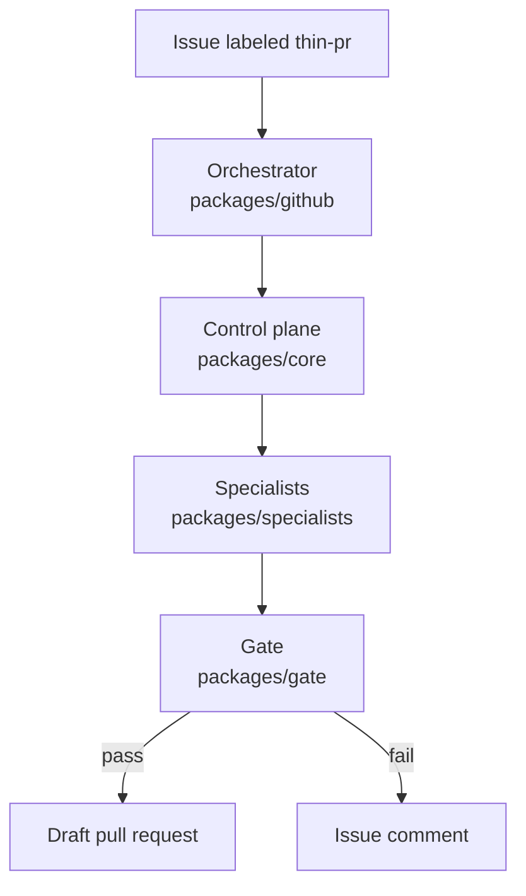

# Thin PR Orchestrator

A GitHub issue goes in. A fixed workflow runs in ordinary TypeScript, calls five specialists through a typed boundary, and opens a draft pull request when the gate passes. A person reviews the draft.

The control plane does not call a model. This tree injects a replay client that returns fixture JSON. The design note is `docs/design.md`.

## Control flow



`packages/github` is the only package that talks to GitHub. It loads `templates/small-feature.yaml` and asks `packages/core` to run that template. The control plane calls planner, implementer, tester, reviewer, and pr-writer, in that order, and appends every transition to SQLite. After pr-writer returns, the gate checks plan, tests, and the five specialist contracts. A pass tells the orchestrator to open a draft pull request. A fail tells it to comment the run report on the issue and open nothing.

## Fork in 5 minutes

Clone, install, then label an issue or replay the evals on your machine.

You need Node.js 22.13 or later. The version file is `.nvmrc`. pnpm 10.33.4 is the `packageManager` field in `package.json`. Corepack ships with Node 22.

```bash
git clone https://github.com/kocherev/thin-pr-orchestrator.git
cd thin-pr-orchestrator
corepack enable
corepack prepare pnpm@10.33.4 --activate
pnpm install
```

Use your fork's URL when you are changing the repo. `.env` is not required for the commands below. If you set a token yourself, copy `.env.example` to `.env` and keep the real value out of git.

### Label an issue

GitHub reads `.github/workflows/thin-pr.yml` from the default branch. Push that branch before you expect a label to start a run. The workflow listens for `issues` with type `labeled`, and the job runs only when the label name is `thin-pr`.

1. Push the default branch so the workflow file is on it.
2. In the repository, create the label `thin-pr`.
3. Open an issue.
4. Add the label `thin-pr`.

The run uses `GITHUB_TOKEN` from the workflow. It creates `thin-pr/<issue number>` from the default branch tip, then adds one commit with that same tree. The commit message is `Prepare thin-pr/#<issue number>`. Checks and the draft pull request use that commit as their head. The file diff stays empty. Recorded diffs under `evals/diffs` are scored offline. They are not pushed.

Each template step posts a check named `thin-pr / <step>`. Each gate rule posts `thin-pr / gate / <rule>`. The rule check title is `PASS` or `FAIL`. The summary is that verdict, a colon, and the reason. The rules are `plan`, `tests`, and `contracts`.

When every rule passes, the run opens a draft pull request into the default branch. The title comes from the pr-writer output. The body is the plan, the test results, and the run report, in that order. A failed step or a failed rule is marked failure, the issue gets a comment that starts with `## Run report`, and no pull request is opened.

Adding the label again tries to create the same branch. If that ref already exists, the run fails and the issue gets another report.

### Replay on your machine

No token and no GitHub repository.

```bash
pnpm eval
pnpm test
```

`pnpm eval` prints the gate pass rate and the diff-budget stats. It exits 0 when the pass rate is at least `evals/baseline.json`. The diff budget is printed and does not change the exit code. `pnpm test` runs Vitest, including the label-path test and the SQLite replay test.

## Example draft pull request

This is the body `packages/github` writes for `fixtures/gate-pass.json` and `fixtures/sample-issue-labeled.json`. The test in `packages/github/src/run.test.ts` drives that pair with run id `run-7`. The pull request title is `Fix the stub`. The head is `thin-pr/7`, the base is `main`, and `draft` is true.

The pr-writer field `body` is not copied into the pull request. The Action builds the body below.

A workflow run writes the same sections. Its run line uses `gha-` plus `GITHUB_RUN_ID` instead of `run-7`.

```text
## Plan

Plan the stub change.

- edit the stub

## Test results

Stub checks passed.

Tests passed.

## Run report

- Run: run-7
- Template: small-feature
- Issue: 7
- Branch: thin-pr/7

### Steps
- plan: success. Plan the stub change.
- implement: success. Apply the stub change.
- test: success. Stub checks passed.
- review: success. Stub review found nothing.
- gate/plan: success. PASS: Plan is present (1 step).
- gate/tests: success. PASS: Tests passed.
- gate/contracts: success. PASS: Specialist outputs match their contracts.
- gate: success. pass
```

`fixtures/gate-fail.json` is the other path. Tests are recorded as not passed, the tests rule fails, the issue gets the run report, and no draft is opened.

## Replay evals

`pnpm eval` replays 12 labeled issues through `templates/small-feature.yaml` and the gate. The model text is the recorded JSON under `evals/responses`. The committed floor in `evals/baseline.json` is a pass rate of 10/12, which the report prints as 83.3%. `evals/budget.json` allows 2 files and 16 lines. `scripts/eval.test.ts` locks this report.

| Stat | Value |
| --- | --- |
| Cases | 12 |
| Gate pass | 10/12, 83.3% |
| Baseline | 83.3% |
| Diff budget | 2 files, 16 lines |
| Within budget | 10/12 |
| Files changed | min 1, median 1, max 4 |
| Lines changed | min 1, median 2.5, max 31 |

| Case | Issue | Gate | Files | Lines | Budget |
| --- | --- | --- | --- | --- | --- |
| 01-clamp-decrement | Clamp decrement at zero | pass | 1 | 2 | within |
| 02-thousands-separator | Format counts with separators | pass | 1 | 2 | within |
| 03-skip-blank-notes | Skip blank note lines | pass | 1 | 2 | within |
| 04-parse-yes-no | Accept yes and no flags | pass | 1 | 4 | within |
| 05-add-reset | Add a reset helper | pass | 1 | 4 | within |
| 06-document-helpers | Document the helpers | pass | 1 | 1 | within |
| 07-format-label | Add an uppercase label | pass | 1 | 4 | within |
| 08-reject-empty-notes | Reject empty note text | pass | 1 | 3 | within |
| 09-failing-tests | Match uppercase true | fail | 1 | 2 | within |
| 10-empty-plan | Rename the helpers | fail | 1 | 1 | within |
| 11-wide-touch | Mark every helper | pass | 4 | 4 | over |
| 12-long-readme | Rewrite the readme | pass | 1 | 31 | over |

`09-failing-tests` records `passed: false`, so the tests rule fails. `10-empty-plan` records `steps: []`. The planner schema requires at least one step, so the plan rule fails. `11-wide-touch` and `12-long-readme` pass the gate and miss the file or line budget. Missing the budget does not fail `pnpm eval`.

## Requirements

- Node.js 22.13 or later. See `.nvmrc`.
- pnpm 10.33.4, from the `packageManager` field in `package.json`.
- TypeScript 6.0.3, installed by `pnpm install`.

`node:sqlite` loads without a flag on Node 22.13 and later, and it is still experimental on that line. `vitest.config.ts` passes `--experimental-sqlite` so the test workers also run on Node 22.5 through 22.12. `pnpm eval` does not pass that flag.

Enable Corepack if `pnpm` is not already on your path.

```bash
corepack enable
corepack prepare pnpm@10.33.4 --activate
```

## Commands

- `pnpm lint` runs ESLint, then `scripts/check-core-boundary.ts`.
- `pnpm typecheck` runs `tsc -b`.
- `pnpm test` runs Vitest.
- `pnpm eval` replays `evals/` and prints the report above. It exits non-zero when the gate pass rate is below `evals/baseline.json`.
- `pnpm build` runs `tsc -b` and writes `dist/` in each project.

`typecheck` and `build` use the same compiler pass. A type error fails both.

To run one file:

```bash
pnpm exec vitest run packages/core/src/run.test.ts
pnpm exec vitest run packages/github/src/run.test.ts
pnpm exec vitest run packages/specialists/src/schema.test.ts
```

The core replay test writes a SQLite log, closes it, opens it again, and expects `replay` to return the same final state as `runWorkflow`. The schema test feeds a reviewer payload whose `notes` entry is a number, then asserts the error path `notes.0`.

## Packages

- `packages/core` is the control plane. Typed code only. No model client imports and no GitHub client imports. `runWorkflow` follows a template. `replay` folds the log back into a run state. `loadTemplate` reads `templates/stub-run.json` and the YAML workflows `bugfix`, `small-feature`, and `docs-update`. Zod checks each file when it loads. A bad template throws with the file line. `ping` returns `pong`.
- `packages/specialists` defines planner, implementer, tester, reviewer, and pr-writer. Each one checks its input and output with Zod. `ReplayModelClient` returns fixture JSON. Invalid output fails the step.
- `packages/gate` evaluates plan, tests, and specialist contracts. `evaluate()` returns `PASS` or `FAIL` and a reason for each rule. `decide(subject)` returns `pass` only when every rule passes. `readiness()` returns `ready`.
- `packages/github` creates the branch, the checks, and the draft pull request. Specialists do not import this package.

`evals/` holds the sample repo, labeled issues, recorded specialist responses, and recorded file contents. See `evals/README.md`.

## CI

`.github/workflows/ci.yml` runs lint, typecheck, test, and eval on pull requests and on pushes to `main`. Eval fails when the gate pass rate drops below `evals/baseline.json`.

## Working notes

See `WORKING.md` and `skills/` before changing the repo. The import ban for `packages/core` is `skills/core-boundary`.

- `packages/core` runs a template, appends every transition to SQLite, and imports no model client. `pnpm lint` fails when that package imports one. `packages/core/src/run.test.ts` expects `replay` to match `runWorkflow`.
- `packages/github` opens a draft pull request only when every gate rule passes. A failed rule comments `## Run report` on the issue and does not open a pull request. The check is `packages/github/src/run.test.ts`.
- `pnpm eval` replays 12 labeled issues offline. The floor in `evals/baseline.json` is 10/12, and the report prints `gate pass rate: 10/12 (83.3%)`.

## License

MIT. See `LICENSE`.
