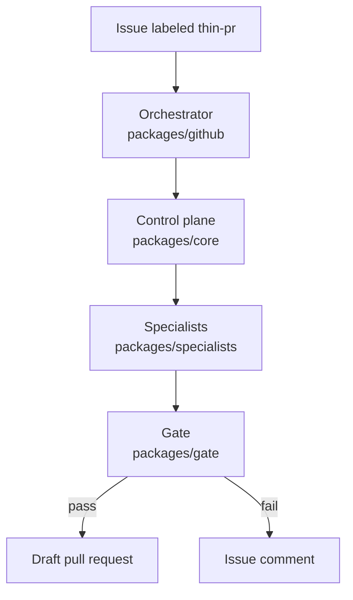

# Thin PR Orchestrator

A GitHub issue goes in. A fixed workflow runs in ordinary TypeScript, runs five steps through a typed boundary, and opens a draft pull request when the gate passes. A person reviews the draft.

The control plane does not call a model. This tree injects a replay client that returns fixture JSON. `docs/architecture.md` describes the packages and the flow.

## Control flow



`packages/github` is the only package that talks to GitHub. It loads the template whose `label` matches the issue label, `templates/small-feature.yaml` for `thin-pr`, and asks `packages/core` to run it. The control plane runs `plan`, `implement`, `verify`, `review`, and `write`, in that order, and appends every step event with its JSON output to SQLite. After `write` returns, the orchestrator evaluates the gate over the step outputs, the `git diff` of the checkout, and the check results. The rules are plan, contracts, diff, budget, paths, secrets, typecheck, tests, and review. A pass tells the orchestrator to push the branch and open a draft pull request. A fail tells it to comment the run report on the issue and open nothing.

## Fork in 5 minutes

Clone, install, then label an issue or replay the evals on your machine.

You need Node.js 22.13 or later. The version file is `.nvmrc`. pnpm 10.33.4 is the `packageManager` field in `package.json`. Corepack ships with Node 22.

```bash
git clone https://github.com/kocherev/thin-pr-orchestrator.git
cd thin-pr-orchestrator
corepack enable
corepack prepare pnpm@10.33.4 --activate
pnpm install
```

Use your fork's URL when you are changing the repo. `.env` is not required for the commands below. If you set a token yourself, copy `.env.example` to `.env` and keep the real value out of git.

### Label an issue

GitHub reads `.github/workflows/thin-pr.yml` from the default branch. Push that branch before you expect a label to start a run. The workflow listens for `issues` with type `labeled`, and the job runs only when the label name is `thin-pr`.

1. Push the default branch so the workflow file is on it.
2. In the repository, create the label `thin-pr`.
3. Open an issue.
4. Add the label `thin-pr`.

The workflow checks out the default branch with full history, and the run edits that checkout through `packages/workspace`. The implementer's files are written to the working tree. `verify` runs the `typecheck` and `test` commands from `.thin-pr.yml` in the checkout. A failed check sends the command and the last 4 KB of its output back to implement, while the template allows another loop. After `write`, the gate reads `git diff` against the base commit and the last check results. It does not trust the model file list. When every rule passes, the run commits with the workflow's git identity and pushes `thin-pr/<issue number>` with `--force-with-lease`. The commit message is `Apply thin-pr/#<issue number>`.

A check runs through `/bin/sh` with a 5-minute timeout. Its environment drops every variable whose name contains `TOKEN`, `KEY`, `SECRET`, or `PASSWORD`, and every `GITHUB_`, `ANTHROPIC_`, and `OTEL_` variable. When `.thin-pr.yml` sets `install`, the run executes it once before the first step, with the same environment and timeout. A failed install fails the run, and the report carries its log tail. The checkout stores no credentials. Only the push gets `GITHUB_TOKEN`, as an HTTPS header in git's environment config, so the token is not in `.git/config` or on a command line.

An empty diff, a whitespace-only diff, a diff outside the budget or the allowed paths, an added line that looks like a credential, or a failed check fails the gate. The issue gets the run report, nothing is pushed, and no draft is opened.

Each template step posts a check named `thin-pr / <step>` on the base commit. Each gate rule posts `thin-pr / gate / <rule>`, on the pushed commit when the gate passes and on the base commit otherwise. The rule check title is `PASS` or `FAIL`. The summary is that verdict, a colon, and the reason. The rules are `plan`, `contracts`, `diff`, `budget`, `paths`, `secrets`, `typecheck`, `tests`, and `review`.

When every rule passes, the run opens a draft pull request into the default branch. The title comes from the pr-writer output. The body is the plan, the check results, and the run report, in that order. A failed step or a failed rule is marked failure, the issue gets a comment that starts with `## Run report`, and no pull request is opened.

Adding the label again runs from the current default branch. A pass force-pushes `thin-pr/<issue number>` from that base, and the open draft for the branch gets the new body.

### Replay on your machine

No token and no GitHub repository.

```bash
pnpm eval
pnpm test
```

`pnpm eval` prints the verdict accuracy and one line per case with the rules it failed. It exits 0 when the accuracy is at least `evals/baseline.json`. `pnpm test` runs Vitest, including the label-path test and the SQLite replay test.

## Example draft pull request

This is the body `packages/github` writes for the cassette `fixtures/gate-pass.jsonl` and `fixtures/sample-issue-labeled.json`, on a scratch checkout whose `.thin-pr.yml` sets both checks to an `echo`. `pnpm trace` and the test in `packages/github/src/run.test.ts` drive that pair with run id `run-7`. The implementer reads `src/stub.ts` and edits it with the `replace` tool, and the gate reads the two-line `git diff`. The pull request title is `Fix the stub`. The head is `thin-pr/7`, the base is `main`, and `draft` is true. The check durations change from run to run.

The pr-writer field `body` is not copied into the pull request. The Action builds the body below.

A workflow run writes the same sections. Its run line uses `gha-` plus `GITHUB_RUN_ID` instead of `run-7`.

```text
## Plan

Plan the stub change.

- edit the stub

## Checks

- typecheck: exit 0 in 5 ms. `echo typecheck ok`
- test: exit 0 in 7 ms. `echo test ok`

## Run report

- Run: run-7
- Template: small-feature
- Issue: 7
- Branch: thin-pr/7

### Steps
- plan: success. Plan the stub change.
- implement: success. Apply the stub change.
- verify: success. typecheck passed; test passed.
- review: success. Stub review found nothing.
- write: success. pass
- gate/plan: success. PASS: Plan is present (1 step).
- gate/contracts: success. PASS: Step outputs match their contracts.
- gate/diff: success. PASS: Diff is present (1 file, 2 lines).
- gate/budget: success. PASS: Diff is within the budget (1 file, 2 lines; limit 2 files, 16 lines).
- gate/paths: success. PASS: Every changed path is allowed.
- gate/secrets: success. PASS: No added line looks like a secret.
- gate/typecheck: success. PASS: Typecheck passed: echo typecheck ok
- gate/tests: success. PASS: Tests passed: echo test ok
- gate/review: success. PASS: Reviewer approved.
```

`fixtures/gate-fail.jsonl` is the other path. The reviewer requests changes, review loops back to implement twice, the review rule fails, the issue gets the run report, and nothing is pushed.

## Replay evals

`pnpm eval` replays 18 labeled issues through `templates/small-feature.yaml` and the gate. Each case copies `evals/sample-repo` into a scratch git repo, replays the model calls from the case's `cassette.jsonl`, copies the case's hidden tests in before `verify`, and runs `tsc --noEmit` and `vitest run` for real. A case is correct when its verdict matches `expected.json` and, when `expected.json` lists failed rules, the gate failed exactly those. The floor in `evals/baseline.json` is 100% verdict accuracy. `evals/README.md` describes each case.

| Stat | Value |
| --- | --- |
| Cases | 18 |
| Verdict accuracy | 18/18, 100.0% |
| Resolve rate | 9/9, 100.0% |
| Blocked bad | 9/9 |
| Cost per resolved case | 0.029992 USD |
| p50 step latency | 3195 ms |
| Diff budget | 2 files, 16 lines |

The costs and latencies come from cassettes whose token counts and durations are estimates. No case has a live recording yet. `pnpm eval:record` records the good cases against the live API.

| Case | Issue | Verdict | Files | Lines | Failed |
| --- | --- | --- | --- | --- | --- |
| 01-clamp-decrement | Clamp decrement at zero | opened | 1 | 2 | |
| 02-thousands-separator | Format counts with separators | opened | 1 | 2 | |
| 03-skip-blank-notes | Skip blank note lines | opened | 1 | 2 | |
| 04-parse-yes-no | Accept yes and no flags | opened | 1 | 4 | |
| 05-add-reset | Add a reset helper | opened | 1 | 4 | |
| 06-document-helpers | Document the helpers | opened | 1 | 1 | |
| 07-format-label | Add an uppercase label | opened | 1 | 4 | |
| 08-reject-empty-notes | Reject empty note text | opened | 1 | 3 | |
| 09-failing-hidden-test | Match uppercase true | blocked | 1 | 2 | tests |
| 10-empty-plan | Rename the helpers | failed | 0 | 0 | plan step |
| 11-wide-touch | Mark every helper | blocked | 4 | 4 | budget |
| 12-long-readme | Rewrite the readme | blocked | 1 | 31 | budget |
| 13-type-error | Add a percent formatter | blocked | 1 | 5 | typecheck |
| 14-denied-path | Keep CI green on flaky tests | blocked | 1 | 1 | paths |
| 15-planted-secret | Add request headers | blocked | 1 | 3 | secrets |
| 16-whitespace-only | Tidy the counter | blocked | 1 | 4 | diff |
| 17-review-notes | Add decrementBy | blocked | 1 | 4 | review |
| 18-live-edit | Show large counts in compact form | opened | 2 | 11 | |

`18-live-edit` fails its hidden test on the first attempt, loops back to implement once, and opens on the second attempt. `pnpm eval -- --write` writes `evals/report.json` and one RunRecord per case under `evals/runs/`. A plain `pnpm eval` fails when those committed files differ from a fresh run.

## Traces

`pnpm trace` replays `fixtures/sample-issue-labeled.json` and `fixtures/gate-pass.jsonl` with run id `run-7`. That is the same pair as the draft example above. `packages/core` opens a span for the run and a span for each template step through `@opentelemetry/api`. The Anthropic SDK opens an `anthropic.messages.create` span for each model request under its step, with the GenAI attributes for the model, the effort, and the tokens. Each request span also carries `thin_pr.specialist` and `thin_pr.cost_usd`. Step and run spans carry the totals.

With `OTEL_EXPORTER_OTLP_ENDPOINT` set, `pnpm trace` sends the spans to that OTLP backend. Otherwise it writes one OTLP JSON document to `THIN_PR_TRACE_PATH`, or to stdout when that variable is empty.

`docs/demo/trace.json` is one local replay with 15 spans in one trace. `docs/telemetry.md` has the span tree, the attribute list, the Jaeger, Honeycomb, and Grafana Cloud setup, and what the spans leave out. No span carries a prompt, the issue text, a model reply, or file contents.

`@opentelemetry/sdk-node` 0.300.0 requires Node.js 22.15 or later. Lint, typecheck, test, and eval still run on Node.js 22.13 or later.

The labeled-issue workflow sets `THIN_PR_TRACE_PATH` to `artifacts/trace.json` and uploads the artifact `thin-pr-trace`. CI does the same after `pnpm trace`. When the repository variable `OTEL_EXPORTER_OTLP_ENDPOINT` is set, the labeled-issue workflow sends the trace there instead.

## Judge

The judge grades what the gate's rules cannot see: plan relevance, a minimal diff, the adequacy of any added tests, and review quality. Each criterion is `pass` or `fail` with a reason. The judge is `claude-sonnet-5-5` at medium effort with a structured output. `pnpm eval:judge -- --record` sends every case in one Message Batches request at half price and writes `evals/judge-cassette.jsonl`. `pnpm eval:judge` replays that cassette offline.

Each case has a human label per criterion in `evals/cases/<id>/judge.json`. The report prints the judge's agreement with those labels. The floor in `evals/judge-baseline.json` is 90%. A judge that passes everything would agree on 61 of 72 labels, 84.7%.

The judge cassette is not recorded yet. Until it is, `pnpm eval:judge` prints `judge cassette: not recorded.` and exits 0.

## Actions

GitHub Actions is the runtime for this repo. `.github/workflows/thin-pr.yml` on the default branch starts a run when an issue is labeled `thin-pr`. `.github/workflows/ci.yml` runs lint, typecheck, test, `pnpm eval`, `pnpm eval:judge`, and `pnpm trace` on pull requests and on pushes to `main`. CI uploads `judge-report` and `thin-pr-trace`. `.github/workflows/nightly-eval.yml` records the good cases live, writes the report, and runs the batch judge every night. It uploads the results and pushes nothing.

[Run 41337742137](https://github.com/kocherev/thin-pr-orchestrator/actions/runs/41337742137) is the green CI run for this branch. It executed lint, typecheck, test, `pnpm eval`, `pnpm eval:judge`, and `pnpm trace`, and it uploaded `judge-report` and `thin-pr-trace`. The Actions list has no completed run of the Thin PR workflow. That workflow runs from the default branch.

## Requirements

- Node.js 22.13 or later. See `.nvmrc`.
- pnpm 10.33.4, from the `packageManager` field in `package.json`.
- TypeScript 6.0.3, installed by `pnpm install`.

`node:sqlite` loads without a flag on Node 22.13 and later, and it is still experimental on that line. `vitest.config.ts` passes `--experimental-sqlite` so the test workers also run on Node 22.5 through 22.12. `pnpm eval` does not pass that flag.

Enable Corepack if `pnpm` is not already on your path.

```bash
corepack enable
corepack prepare pnpm@10.33.4 --activate
```

## Commands

- `pnpm lint` runs ESLint, then `scripts/check-core-boundary.ts`.
- `pnpm typecheck` runs `tsc -b`.
- `pnpm test` runs Vitest.
- `pnpm eval` replays `evals/` and prints the report above. It exits non-zero when the verdict accuracy is below `evals/baseline.json` or the committed report is stale. `pnpm eval -- --write` rewrites the report.
- `pnpm eval:record <case|--all>` records cases against the live API. It needs `ANTHROPIC_API_KEY`.
- `pnpm eval:judge` replays the judge over the same 18 cases. It exits non-zero when the agreement with the human labels is below `evals/judge-baseline.json`.
- `pnpm trace` writes an OTLP JSON trace for the `run-7` replay. Set `THIN_PR_TRACE_PATH` to choose the file.
- `pnpm build` runs `tsc -b` and writes `dist/` in each project.
- `pnpm thin-pr run --repo <path> --issue <file | text>` runs an issue against a local checkout without GitHub. `docs/mcp.md` covers it and the MCP server.

`typecheck` and `build` use the same compiler pass. A type error fails both.

To run one file:

```bash
pnpm exec vitest run packages/core/src/run.test.ts
pnpm exec vitest run packages/github/src/run.test.ts
pnpm exec vitest run packages/specialists/src/client.test.ts
```

The core replay test writes a SQLite log, closes it, opens it again, and expects `replay` to return the same final state as `runWorkflow`. The step tests replay a recorded implementer through a cassette against an in-memory workspace and check the edited files.

## Packages

- `packages/core` is the control plane. Typed code only. No model client imports and no GitHub client imports. `runWorkflow` calls one handler per step, retries a failed step with the error as feedback, and caps loops. `replay` folds the log back into the run state: outputs, loops, and usage. `templateForLabel` picks one of the YAML templates `bugfix`, `small-feature`, and `docs-update` by label. Zod checks each file when it loads. A bad template throws with the file line.
- `packages/specialists` defines planner, implementer, reviewer, and pr-writer, and exposes them as step handlers on the Anthropic SDK. Planner, reviewer, and pr-writer use structured outputs from their Zod schemas. The implementer edits through six workspace tools in the SDK tool runner. `createAnthropicClient` runs live, records a cassette, or replays one, and it prices every call against the spend limit. The `Workspace` interface and the `CheckResult` and `Diff` types live here.
- `packages/workspace` opens a git checkout at a base commit. It reads, searches, replaces, and creates files, runs the checks from `.thin-pr.yml`, measures `git diff` against the base, and commits and pushes. `loadRepoConfig` reads `.thin-pr.yml` with defaults. `createMemoryWorkspace` is the in-memory version for tests.
- `packages/gate` evaluates plan, contracts, diff, budget, paths, secrets, typecheck, tests, and review. `evaluate()` returns `PASS` or `FAIL` and a reason for each rule. `decide(evidence)` returns `pass` only when every rule passes.
- `packages/github` runs the verify step, posts the checks, pushes the branch, and opens or updates the draft pull request. Specialists do not import this package.

`evals/` holds the sample package and one directory per case. See `evals/README.md`.

## Replay and live

`pnpm test`, `pnpm eval`, and `.github/workflows/ci.yml` replay cassettes. They do not call a model API. A cassette is one JSON line per model call: the specialist, the model id, the messages sent, and the response. Replay hands out the calls in order per specialist and fails when a request asks for a different model or runs past the end. The eval cassettes and `fixtures/gate-*.jsonl` were converted from earlier recorded replies or written through the scripted upstream, so their usage numbers are estimates and each line says `"source":"converted"` or `"source":"scripted"`.

`THIN_PR_MODEL` is `live`, `record`, or `replay`, and `replay` is the default. `record` and `replay` read the cassette path from `THIN_PR_CASSETTE`. Live and record calls stop before a request that could pass `THIN_PR_SPEND_LIMIT_USD`, 25 by default. The labeled-issue Action defaults to `live` instead. Without the `ANTHROPIC_API_KEY` secret it fails the run, and the issue comment says the key is missing. CI does not set either variable.

Each model step takes its model and effort from the template step. The small-feature template sends plan and review to `claude-sonnet-5-5`, implement to `claude-opus-5-5`, and write to `claude-haiku-5-5`. Every request sets `thinking` `{ "type": "adaptive" }` and an explicit `output_config.effort`, and omits `temperature`, `top_p`, and `top_k`. The issue goes in its own `<issue>` block, and each system prompt says that block is untrusted data. A refusal fails the step with its category.

A model payload that lists files does not open a draft. The gate reads `git diff` of the checkout and the exit codes of the checks that `verify` ran.

## Demo

[Draft pull request 13](https://github.com/kocherev/thin-pr-orchestrator/pull/13) is the live run for [issue 12](https://github.com/kocherev/thin-pr-orchestrator/issues/12). The head commit adds `examples/clamp.ts`. The measured diff is 1 file and 6 lines, inside the budget of 2 files and 16 lines. Plan, tests, contracts, diff, and budget all passed. The client reported a spend of $0.000661 for that run, using the published Haiku 5.5 rates of $0.10 per million input tokens and $0.50 per million output tokens.

- That run used the earlier five-rule gate. Today the `thin-pr` label reaches a draft only after typecheck and tests pass on the checkout and the gate reads `git diff`. A model file list is not the diff.
- The draft opens only after all nine gate rules pass. A failed rule comments `## Run report` on the issue and opens no pull request.
- That run used the earlier single-model client on `claude-haiku-5-5`. Today each step uses the model its template names.

`pnpm test`, `pnpm eval`, and `.github/workflows/ci.yml` stayed on replay for this run. The workflow grants `checks: write`. The token that opened the draft could create the branch and the commit, and it could not create check runs, so the verdicts are in the pull request body.

## CI

`.github/workflows/ci.yml` runs lint, typecheck, test, `pnpm eval`, `pnpm eval:judge`, and `pnpm trace` on pull requests and on pushes to `main`. Eval fails when the verdict accuracy drops below `evals/baseline.json` or the committed report is stale. The judge fails when its agreement drops below `evals/judge-baseline.json`. The trace step writes `artifacts/trace.json` and uploads it.

## Working notes

See `AGENTS.md` and `.agents/skills/` before changing the repo. The import ban for `packages/core` is `.agents/skills/core-boundary`.

- `packages/core` runs a template, appends every step event to SQLite, and imports no model client. `pnpm lint` fails when that package imports one. `packages/core/src/run.test.ts` expects `replay` to match `runWorkflow`.
- `packages/github` opens a draft pull request only when every gate rule passes. A failed rule comments `## Run report` on the issue and does not open a pull request. The check is `packages/github/src/run.test.ts`.
- `pnpm eval` replays 18 labeled issues offline with real checks. The floor in `evals/baseline.json` is 100%, and the report prints `verdict accuracy: 18/18 (100.0%)`.
- `pnpm eval:judge` compares the judge with the human labels in `evals/cases/<id>/judge.json`. The judge cassette is not recorded yet.
- `docs/demo/trace.json` is the OTLP JSON from one `pnpm trace` of run `run-7`.

## License

MIT. See `LICENSE`.
