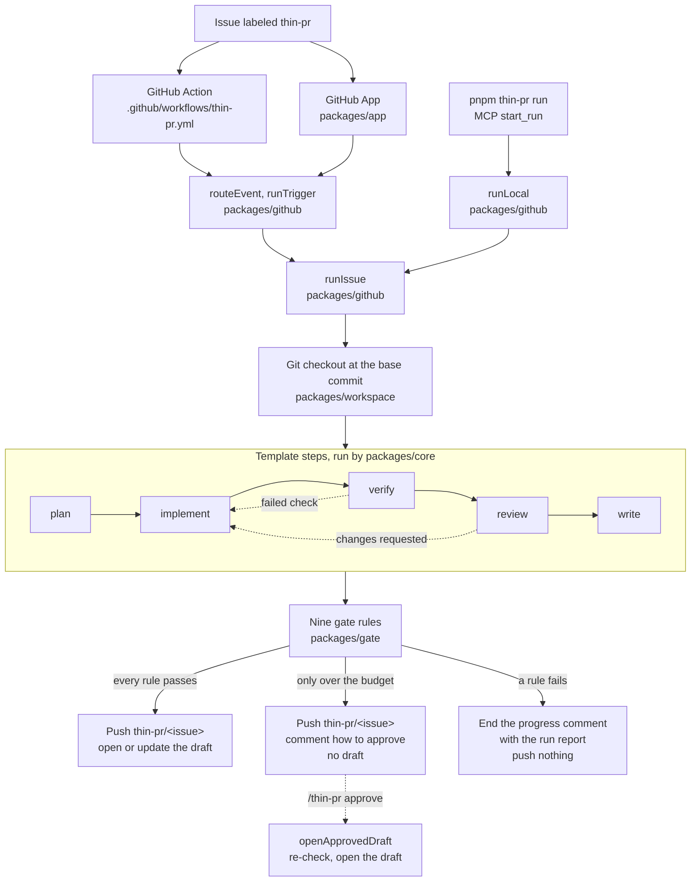

# Architecture

How a labeled issue becomes a draft pull request, which package owns each part, and what the system refuses to do.

## Flow



The Action and the App answer the same events through the same router. The App defers to an enabled thin-pr workflow, so only one of them runs. `docs/deploy.md` has the rule and the App setup. The command line and the MCP server run the same `runIssue` against a local checkout and never push. `docs/mcp.md` covers them.

## Events

`routeEvent(name, payload)` in `packages/github/src/router.ts` parses each webhook with Zod and returns a trigger, or the reason it ignores the event. It imports only Zod, so the Worker bundles it too. `runTrigger` in `packages/github/src/trigger.ts` runs a trigger against a checkout. The Action calls both with `github.context`. The Worker calls `routeEvent` on the delivery and queues the trigger, and the container calls `runTrigger`. Each entry point passes the login the app comments as, `github-actions[bot]` for the Action and `<GITHUB_APP_SLUG>[bot]` for the App.

| Event | Router reads | Action |
| --- | --- | --- |
| `issues.labeled` | label `thin-pr` or `thin-pr:<template>` | A label run of that template: `runLabel`, then `runIssue`. |
| `issue_comment.created` | first line `/thin-pr approve`, `retry`, `cancel`, or another word | `runCommand` in `packages/github/src/commands.ts`. |
| `pull_request_review.submitted` | state `changes_requested` or `commented`, on an open `thin-pr/<issue>` draft in the same repository | A revise run of that review: `runRevise` in `packages/github/src/revise.ts`. |
| `pull_request_review_comment.created` | the review the comment belongs to, on the same kind of draft | The same revise run. |

The router ignores every event a bot sends, every command and review from a user who is not an owner, member, or collaborator, approvals, and drafts on other branches or forks. `docs/security.md` has the checks.

Commands:

- `/thin-pr approve` reads the stored run from the newest run comment the app's bot account wrote on the issue and calls `openApprovedDraft`, which re-checks it. On success the run comment becomes the approved report and keeps no stored run.
- `/thin-pr retry` starts a fresh label run with the first `thin-pr` label on the issue.
- `/thin-pr cancel` deletes the branch of the run that waits for approval and ends its comment with status `cancelled`. It keeps a branch that moved after the run.
- Any other word gets a reply that lists the three commands.

A command on a draft acts on the issue its `thin-pr/<issue>` branch names. The command comment gets an `eyes` reaction, then `+1` when the command ran or `confused` with a short reply when it was refused.

## Revise runs

A review on a draft starts the `revise` template on the draft branch, checked out at its head. The issue label never selects it.

- The plan step calls no model. Its output is one step per review comment, built from the review text and each inline comment's file, line, and body.
- Implement gets the whole review as feedback on every pass, ahead of any loop feedback from verify or review.
- Verify, review, write, and the gate run as in a label run. The gate measures the new commit only, so `budget` uses the revise template's limits on the revision.
- A pass commits on top of the branch and pushes. The gate checks go on the new commit. One reply on the pull request shows the progress and ends with a table of each inline comment and whether the commit changed its file.
- A failure, a spend stop, or a revision over the budget pushes nothing and ends the reply with the reason and the run report.

GitHub sends one review event and one comment event per inline comment, and every one of them names the review. The reply carries a hidden marker with the review id, and a revise run that finds its own reply for the review stops. The workflow's concurrency group queues the events per pull request. The Worker keys the job and the container by `review-<id>`, and the container's server starts a key once.

## Packages

| Package | Owns | Does not |
| --- | --- | --- |
| `packages/core` | Template loading, the step machine with retries and bounded loops, the SQLite run log, `replay`, run and step spans. | Import a model client or a GitHub client. `pnpm lint` fails on either. |
| `packages/specialists` | The Zod output contracts, the system prompts, `createAnthropicClient` with replay, record, and the spend meter, the planner, implementer, reviewer, and pr-writer handlers, and the judge. The `Workspace` interface lives here. | Import `packages/github`. |
| `packages/workspace` | The git checkout a run edits: file tools, the check runner, `git diff` against the base, commit and push, and `.thin-pr.yml`. `createMemoryWorkspace` is the in-memory version for tests. | Call a model. |
| `packages/gate` | Nine pure rules over the run evidence. `evaluate` returns a verdict and a reason per rule. `decide` returns `pass` when all nine pass, `needs_approval` when only the budget is over, and `fail` otherwise. | Read the model's own claims about the change. |
| `packages/github` | The only GitHub client. It routes each webhook event, runs `verify`, posts check runs, keeps the progress comment, builds the RunRecord, writes the draft body and the run report, pushes, opens the draft, answers commands, and revises a draft for a review. It also holds the Action entry, `runLocal`, and the CLI. | Live inside `packages/core`. |
| `packages/app` | A Cloudflare Worker that verifies the webhook, routes it with the router from `packages/github`, queues the trigger, mints an installation token, and starts a container that calls `runTrigger`. | Run the workflow itself. |
| `packages/mcp` | A stdio MCP server with `list_runs`, `get_run`, `replay_case`, and `start_run`. | Push or call GitHub. |
| `apps/console` | A static Next.js export of the RunRecords in `evals/runs/` and the report in `evals/report.json`. | Call an API at runtime. |

## Step model

A loop that keeps calling a model until it decides it is done hides three decisions: which step runs next, how many times a step may retry, and whether a pull request opens. Here the template decides the first two, and the gate decides the third. The template is YAML, and the gate is nine pure functions.

A template is YAML data under `templates/`. Its `label` selects it. `budget` sets the review size, `max_files` and `max_lines`, that a run may reach before a person must approve it, and `spend_usd` caps one run's model spend. Each step names its id, an optional model and effort, a retry count, and an optional loop. `templates/README.md` lists the four templates.

```yaml
id: feature
label: thin-pr
budget: { max_files: 12, max_lines: 600 }
spend_usd: 5
steps:
  - { id: plan,      model: claude-sonnet-5-5, effort: medium, retries: 1 }
  - { id: implement, model: claude-opus-5-5,   effort: high,   retries: 1 }
  - { id: verify,    retries: 0, loop: { back_to: implement, max: 2 } }
  - { id: review,    model: claude-sonnet-5-5, effort: high,   retries: 1, loop: { back_to: implement, max: 2 } }
  - { id: write,     model: claude-haiku-5-5,  effort: low,    retries: 1 }
```

`runWorkflow` in `packages/core` calls one handler per step and appends every event to the log.

- `retries` is the number of extra attempts after a failed one. Each retry gets the previous error as feedback.
- A handler may return `loop` with feedback. The run goes back to `loop.back_to`. `loop.max` caps those loops for the whole run, and core fails the run when a step asks for one more.
- `verify` and `review` stop asking for a loop on their last allowed pass and finish instead. The gate then names the failed check or the review verdict, so core does not fail the run at the cap.
- A template that names a step twice, gives `verify` a model, or loops to a step that is not earlier fails to load with `TemplateError` and the file line.

The five steps:

| Step | Handler | Model | Output |
| --- | --- | --- | --- |
| `plan` | planner | structured output | `summary` and at least one entry in `steps` |
| `implement` | implementer | tool runner over the workspace | `summary`, and `files` from `workspace.diff()` |
| `verify` | `createVerifyHandler` in `packages/github` | none | `summary` and the `typecheck` and `test` results |
| `review` | reviewer | structured output | `verdict`, `approve` or `changes_requested`, and `notes` |
| `write` | pr-writer | structured output | `title`, `body`, and `summary` |

The gate is not a step. `runIssue` evaluates it after `write` finishes. `runIssue` lives in `packages/github` because it posts checks and pushes. Moving it into `packages/core` would put a GitHub client there, which `pnpm lint` forbids.

## Specialists

Each model step takes its model and effort from the template step, or from the specialist default when the step names none. Every request sets `thinking` to adaptive and an explicit `output_config.effort`. It omits `temperature`, `top_p`, and `top_k`. Opus 5.5 and Sonnet 5.5 requests opt into the server-side fallback.

The planner, reviewer, and pr-writer are structured-output calls built from their `.strict()` Zod schemas. The planner's call also carries `read_file` and `search`, so it can read the files it is about to name. Its tool loop stops after 8 turns. A reply that still fails the schema throws `SpecialistSchemaError` with the specialist, the phase, and the path of the first issue. A refusal fails the step with its category. A reviewer or pr-writer reply cut off at `max_tokens` is retried once with twice the room. A cut-off planner reply fails the attempt, and the step retries.

The implementer runs in the SDK tool runner with six strict tools: `list_files`, `read_file`, `search`, `replace`, `create_file`, and `run_check`. It stops when the model stops asking for tools, and fails after 60 turns. A feature can touch 12 files, and reading, editing, and checking that many took more than the old 25. The run's `spend_usd` caps what a long loop costs. The request turns on context editing with `clear_tool_uses_20250919`: past 60,000 input tokens the API clears old tool results, keeps the 6 most recent tool calls, and clears at least 20,000 tokens at a time, since each clear invalidates the cached prefix. The API does this on its side, so the tool runner keeps the full history unchanged. A model never reports which files changed. The `files` field comes from `git diff`.

The planner reads the issue and the repository's tracked paths, up to 500 of them, and can read and search files, so each step names a real file.

An attempt that fails after a model call throws `StepError` with that call's usage. Core keeps it on the `failed` event, so the run totals count refused and retried calls. A `StepError` with `retryable: false` stops the run without the remaining retries. The specialists throw one for a spend limit, since every retry would hit it too.

Each run's session has two spend limits. `THIN_PR_SPEND_LIMIT_USD`, 25 USD by default, covers the whole client. The template's `spend_usd`, or the `.thin-pr.yml` override, covers one run: `createRunHandlers` passes it to the meter with `limitRun`. Before each live call the meter prices the largest reply the request allows, plus the same specialist's previous request and reply as uncached input, since a tool loop sends them again. When that could pass either limit, the call is not sent, the run fails, and the report says which limit and how much was spent.

The reviewer reads the plan, the workspace patch, and the verify results. `changes_requested` loops back to implement with the notes as feedback while the template allows another loop.

## Data flow

1. `runIssue` creates the progress comment on the issue, then runs `install` from `.thin-pr.yml` once, when the file sets one. A failed install fails the run with its log tail.
2. `runWorkflow` runs the template. Each event goes to the SQLite log with its full JSON output and model usage. `onEvent` opens and closes one check run per step, named `thin-pr / <step>`, on the base commit, and edits the progress comment: each step's status, attempt, loop, and cost, the total so far, and a link to the Actions run or the App delivery.
3. After the run, `runIssue` measures `workspace.diff()` and reads the last verify output. Those two values and the parsed plan and review are the gate's evidence.
4. When every rule passes, `runIssue` commits the checkout and force-pushes `thin-pr/<issue>` with a lease. It posts one check per rule, named `thin-pr / gate / <rule>`, on the new commit, then opens a draft or updates the open one.
5. When only `budget` asks for approval, `runIssue` pushes the branch and posts the rule checks the same way, with `budget` as a neutral check. It opens no draft. It ends the progress comment with the run report, the changed files, the command `/thin-pr approve`, and a hidden marker that stores the run. An open draft for the branch gets the report as its body. `/thin-pr approve` calls `openApprovedDraft` in `packages/github/src/approval.ts`, which re-checks the stored run and the branch head, then opens the draft. `docs/gate.md` has the checks.
6. When a rule fails, `runIssue` posts the rule checks on the base commit and ends the progress comment with the run report. Nothing is pushed.

`gatedRun` in `packages/github/src/run.ts` holds steps 1 to 3 and 6. A label run and a revise run differ only in how they publish a pass.

The draft body and the final progress comment come from one function, `formatRunReport` in `packages/github/src/report.ts`. The comment of an opened run also links to the draft. Each starts with a one-line outcome and the gate table, failing rules first. Then come the cost, the tokens, and the duration for the run and for each model. A run over the budget also gets an open section that lists each changed file with its added and removed lines. Collapsible sections hold the plan, each check's exit code and log tail, the review verdict and notes, and one row per step attempt with its loop count. The pr-writer `title` becomes the draft title, or `thin-pr #<issue>` when the title is missing. Its `body` field is not used. The gate and the body read the parsed outputs from the run, never the model text a second time.

`replay(events)` folds a stored log back into the final state: outputs, loops, and usage. `packages/core/src/run.test.ts` checks that it matches what `runWorkflow` returned. `toRunRecord` turns the timed events into a RunRecord, the JSON shape the MCP server, the evals, and `evals/runs/` use.

`runWorkflow` also opens a span for the run and one for each pass over a step. The Anthropic SDK's request spans nest under the step spans. A process that never starts the OpenTelemetry SDK records nothing. `docs/telemetry.md` has the span tree and the attributes.

## Evals and the judge

`pnpm eval` replays 26 labeled issues against `evals/sample-repo` with real `tsc` and `vitest` and against `evals/sample-python` with real `python3`, and `pnpm eval:judge` grades the replayed runs against human labels. `evals/README.md` describes both, the cases, and the nightly live run. `docs/gate.md` lists the case that trips each rule.

## Non-goals

- CI and `pnpm eval` do not call a live model. They replay cassettes.
- The run pushes only after the gate passes or asks for approval, and only to `thin-pr/<issue>`. A revise run pushes one commit on top of that branch. Nothing merges, requests reviewers, or closes the issue.
- There is no chat UI, no second orchestrator, and no open-ended agent loop. The implementer's loop is capped at 60 turns and the planner's at 8, and their tools reach only the workspace. There is no shell tool.
- `packages/core` does not grow a model SDK import or a GitHub client import. `.agents/skills/core-boundary` is the list.
